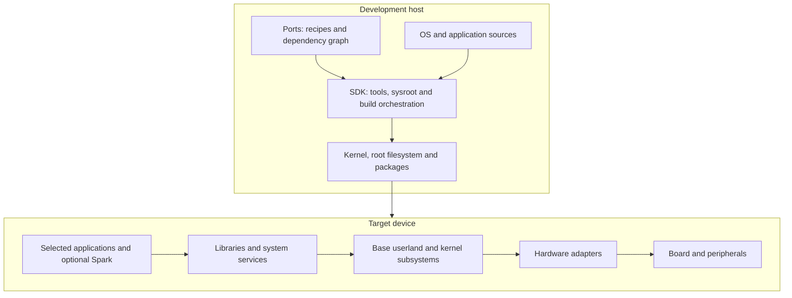

# Concept and architecture

[Guide](../README.md) · [Next: modularity](modularity.md)

EmberBSD combines a BSD operating system with optional software for a device's task.
A device can run a console application, a graphical interface, or an agent.
The base OS supplies processes, memory, files, networking, permissions, and hardware access.
It does not require Spark, an AI provider, a desktop, or the planned Runtime.

## Two execution environments

The development host prepares software. The target device runs it.
Host and target can have different CPUs and operating systems.
Native generators run on the host; cross-compiled programs use the target ABI.

The arrows show dependencies and delivery, not a required call path for every operation.
An application can call an OS interface directly.
The planned Runtime is absent from this diagram because current applications do not depend on its implementation.

## The system's main boundaries

| Boundary | Shared interface | Implementation choice |
| --- | --- | --- |
| Application to OS | Supported POSIX/BSD interfaces and target C ABI | Kernel and base implementation |
| File operations to storage | VFS and filesystem semantics | Filesystem and block/flash backend |
| Subsystem to hardware | Bus interfaces, capabilities, callbacks, and ownership rules | Chip driver and firmware ABI |
| Application to service | Documented protocol, messages, and errors | Service implementation and transport |
| Build to target | Target identity, sysroot, runtime, and package metadata | Host platform and selected toolchain |

VFS and driver interfaces are internal OS contracts. They are not portable application APIs.
Target compatibility identifiers can retain NetBSD names where the ABI and tools require them.
EmberBSD still uses its own matching kernel, headers, libc, and integration sources.

## One shared stack, selected components

Ports maintains common dependency recipes and patches.
Different target ABIs need separate binaries from those recipes.
A board selects hardware integration and task packages; it does not require a separate copy of every library.

For example, a sensor application can use the base OS and its protocol library.
A desktop adds graphics libraries and a session. Spark adds agent dependencies and configuration.
These are composition examples, not named installable profiles or claims of universal board support.

## Where to go deeper

- [OS purpose and ecosystem](https://github.com/oxtech-ember/EmberBSD/blob/main/README.md)
- [Source and documentation ownership](https://github.com/oxtech-ember/EmberBSD/blob/main/doc/emberbsd-ownership.md)
- [SDK build workflow](https://github.com/oxtech-ember/EmberBSD-SDK/blob/main/docs/build-workflow.md)
- [Hardware catalog](https://github.com/oxtech-ember/EmberBSD-DevBoards/blob/main/README.md)
