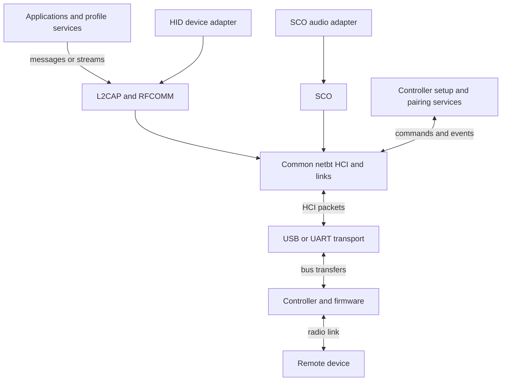

# Bluetooth

[Modules](README.md) · [Networking](networking.md) · [Driver interfaces](https://github.com/oxtech-ember/EmberBSD/blob/main/sys/netbt/docs/README.md)

Bluetooth support has three separate parts: a controller transport, a host protocol stack, and a service profile.
A new controller usually needs transport and initialization work. A new peripheral may only need an existing profile.
The controller's reported Bluetooth version does not describe all capabilities of the operating system.

**Current boundary:** EmberBSD has a native BR/EDR stack and several Classic profiles.
LE command definitions exist, but the reviewed stack has no integrated LE connection, ATT/GATT, SMP or LE Audio path.
The [source baseline](../sources.md#bluetooth-review) identifies the reviewed implementation.
Device applicability, firmware selection, wiring and physical acceptance remain in [DevBoards](https://github.com/oxtech-ember/EmberBSD-DevBoards).

## Architecture

BR/EDR means Basic Rate / Enhanced Data Rate, commonly called Bluetooth Classic.
HCI is the Host Controller Interface between host software and the radio controller.
The controller handles radio timing and link-level operations. The host manages connections, channels, security policy and services.
The [Bluetooth Core architecture](https://www.bluetooth.com/wp-content/uploads/Files/Specification/HTML/Core_v6.3/out/en/architecture,-change-history,-and-conventions/architecture.html) defines this separation.

This diagram shows the current Classic path. Profile data and control do not always use the same channel.
A2DP audio travels over L2CAP; headset control uses RFCOMM while its audio uses SCO.
SDP discovers service endpoints. It does not itself connect the application to that service.

| Module and owner | Responsibility |
| --- | --- |
| Platform and bus support — OS | Power, reset, IRQ, UART/USB resources and shared-radio constraints |
| Controller transport — OS | HCI framing, transfer queues, errors, device initialization and transport teardown |
| `netbt` — OS | HCI command/data credits, link state, packet dispatch, L2CAP channels, RFCOMM streams and SCO |
| `libbluetooth`, SDP tools and `sdpd` — OS | Native controller access, service discovery and local service registration |
| Pairing and key services — OS | User authorization, persistent bonds and the selected security procedure |
| Profiles — OS or their application/package owner | HID reports, audio, serial access or PAN networking using common protocols |
| Application — its repository | Peer/service selection and application data; no private copy of HCI or pairing logic |

Keep standard protocol state above the transport driver. Firmware loading and vendor commands stay with their actual device integration.
For combo radios, coordinate firmware, reset and power with the other radio consumer.
An HCI driver does not need its own keyboard, audio, GATT or pairing implementation.

## Protocols and transport standards

The table describes implemented paths, not blanket conformance to a Core Specification version.
Check host behavior, controller features, peer capabilities and the selected profile together.

| Interface or protocol | Current boundary |
| --- | --- |
| USB HCI | `ubt` carries commands, events, ACL and SCO using their USB transfer paths. Firmware loading and device quirks are separate. |
| UART HCI H4 / H5 | `btuart` implements H4 framing. `bth5` implements the three-wire transport. `btattach` selects the line discipline and initialization. H5 availability does not qualify every UART controller. |
| BCSP | A separate serial transport for the BlueCore protocol; it is not another name for every H5 device. |
| BR/EDR HCI and ACL | Native command/event handling, connection state, controller credits and ACL fragmentation/reassembly exist. Feature reporting is not profile acceptance. |
| L2CAP | Connection-oriented Basic Mode channels exist. The reviewed feature response does not advertise Enhanced Retransmission or Streaming Mode. There is no native LE credit-based channel path. |
| RFCOMM and SDP | Stream channels and Classic service discovery/registration exist. A UUID or SDP record alone does not implement a service. |
| SCO | Native sockets and an audio adapter exist. Do not infer general eSCO, wideband speech or LE ISO support from controller feature bits. |
| LE / ATT / GATT / SMP | `hci_le.h` defines commands and events. The reviewed `netbt` dispatch and channel implementation do not supply an integrated LE host. Raw HCI access alone does not provide these protocols. |
| LE Audio and Bluetooth Mesh | No integrated implementation in the reviewed path. LE Audio needs isochronous transport, codec and profile support; Mesh needs its own shared protocol/service implementation. |

Use the [Bluetooth SIG specification index](https://www.bluetooth.com/specifications/specs/) for protocol and profile definitions.
The [LE Audio specification map](https://www.bluetooth.com/learn-about-bluetooth/feature-enhancements/le-audio/le-audio-specifications/)
shows why adding LC3 alone would not provide LE Audio: ISO transport, BAP and related services are also required.

## Profiles and application integration

| Profile or service | Current implementation and limit |
| --- | --- |
| Classic HID | `btdevctl` obtains service information; `bthub` attaches `bthidev`; report handlers feed `wscons` keyboard/mouse interfaces. This is not HID over GATT (HOGP). |
| Serial Port Profile (SPP) | `rfcomm_sppd` provides client/server serial access over RFCOMM. BLE serial-like GATT services are different protocols. |
| Personal Area Networking (PAN) | `btpand` implements BNEP with PANU, GN and NAP roles through `tap`. Bridging, addressing and routing remain normal network configuration. |
| A2DP | `bta2dpd` implements source and sink paths through AVDTP/L2CAP with SBC. It does not establish AAC, aptX, LDAC or AVRCP support. |
| Headset audio | `btsco` supplies the SCO audio path; `bthset` supplies headset control and volume handling over RFCOMM. |
| Hands-Free Profile (HFP) | `btdevctl` recognizes the HF service and `btsco` can listen for audio. These pieces are not a complete HFP call-control and codec-negotiation implementation. |
| AVRCP, OBEX-based services, LE profiles | No complete native integration is established by these base components. Add the profile's actual state machine and consumer; reusing its underlying channel is insufficient. |
| Desktop Bluetooth UI | Ports' [BluezQt](https://github.com/oxtech-ember/EmberBSD-Ports/blob/main/pkgsrc/net/kf6-bluez-qt/DESCR) and [Bluedevil](https://github.com/oxtech-ember/EmberBSD-Ports/blob/main/pkgsrc/x11/plasma6-bluedevil/DESCR) are BlueZ D-Bus clients. They do not supply a native adapter backend. |

The [owner map](https://github.com/oxtech-ember/EmberBSD/blob/main/sys/netbt/docs/README.md#profiles-and-native-applications)
links these implementations and their exact interfaces.
Choose the profile first when adding a remote peripheral. Add a controller driver only when its HCI transport is missing.

## Pairing, bonds and authorization

Pairing establishes keys; bonding retains them for later connections. Service authorization is a separate decision.
`bthcid` owns Classic PIN handling and persistent link keys.
EmberBSD's controller and pairing helpers add a bounded outgoing BR/EDR SSP / Secure Connections workflow for one selected peer.
They are not a complete general pairing agent for every role and association method.

The default helper path uses numeric comparison. Just Works and legacy PIN are explicit alternatives with different security properties.
Just Works does not authenticate a displayed number. A stored bond does not grant every application access to every service.
The native socket mode named `secure` requests encryption and a link-key change; its name does not mean LE Secure Connections.
Read the [security implementation map](https://github.com/oxtech-ember/EmberBSD/blob/main/sys/netbt/docs/README.md#security-and-startup) for exact behavior.

Keep bond material local to the installation. Packet traces can contain keys and application data.
Use controller identity, peer identity and current connection state when handling asynchronous security events.
An event for another peer must not authorize the selected connection.

## Configuration choices

Select the kernel Bluetooth stack, the actual controller transport, and any kernel profile adapters the application needs.
Then select firmware initialization, controller policy, pairing/key services, discovery and the intended profile service.
A controller marked running is only one stage of this path.

The base `bluetooth` rc service and the platform-scoped `ember_bluetooth` integration have different startup scopes.
Use the installed image's owning path and keep one startup owner for a controller.
The [source map](https://github.com/oxtech-ember/EmberBSD/blob/main/sys/netbt/docs/README.md#security-and-startup)
links their actual configuration and helper dependencies. Hardware applicability remains in DevBoards.

Desktop services and D-Bus are optional. A serial, HID or PAN scenario can use native interfaces directly.
For PAN, Bluetooth transports Ethernet frames; IP configuration remains above that transport.

## Adding a controller or device adapter

1. **Identify the missing boundary.** Reuse a matching USB/UART transport or existing profile before adding a driver.
   Distinguish a standard HCI controller from firmware that exposes a proprietary application-service protocol.
2. **Connect hardware resources.** Use the native bus, interrupt and power mechanisms. Coordinate firmware/reset with shared consumers.
3. **Implement the common HCI contract.** Supply lifecycle, output and statistics callbacks; deliver complete packets to `netbt`.
   Keep command credits, connection state and upper protocols in the common stack.
4. **Preserve lifetime and ordering.** Respect packet ownership, flow control, partial transfers, queue limits and detach completion.
   Bus transmit completion and controller packet completion are different events.
5. **Connect the intended profile.** Use sockets for userland services or the existing kernel protocol callbacks for device adapters.
   Add missing shared protocol operations at their owner before another driver depends on them.
6. **Check the complete scenario.** Test malformed packets, enable/disable, failed initialization, disconnect and pending transfers.
   Then test pairing, the actual profile and sustained traffic. Inquiry alone proves none of those later stages.

## Proposed direction for missing capabilities

**This section is a design recommendation, not implemented support or an approved API.**
Extend the native stack around one owner for controller commands, credits and connection state.
Keep reusable protocols common to all USB/UART adapters. Keep user interaction and profile policy outside drivers.

The recommendation follows these upstream designs, adapted to the existing EmberBSD stack:

| Reference | Useful practice | Application to EmberBSD |
| --- | --- | --- |
| [FreeBSD Bluetooth](https://docs.freebsd.org/en/books/handbook/advanced-networking/#network-bluetooth) | Separate HCI, L2CAP, sockets, security service and SDP | Reuse BSD behavior and tests where applicable; retain native `netbt` interfaces rather than introducing Netgraph. |
| [Zephyr architecture](https://docs.zephyrproject.org/latest/services/connectivity/bluetooth/bluetooth-arch.html) | Transport-independent host, separate controller, selectable protocol features | Keep USB/UART adapters small and optional features explicit. Use an HCI controller without importing its radio implementation into the host. |
| [Apache NimBLE](https://github.com/apache/mynewt-nimble/blob/master/README.md) | Common GAP/ATT/GATT/SMP implementations and an OS porting layer | Evaluate protocol code and tests as donors with their licenses. A full second host would duplicate HCI/L2CAP ownership; it is not a drop-in GATT library. |
| [BlueZ management](https://github.com/bluez/bluez/blob/master/doc/mgmt-protocol.rst) and [GATT API](https://github.com/bluez/bluez/blob/master/doc/org.bluez.GattManager.rst) | Explicit management requests/events and application service registration | Adopt the separation of mechanism and policy. BlueZ's Linux control socket is absent here; compiling its client libraries does not port that contract. |

For this stack, extending `netbt` is the preferred route. Running another host through raw HCI would create competing owners.
Keep native APIs usable without D-Bus. Add an optional BlueZ-compatible application service only for actual desktop consumers.
That service must translate implemented operations and errors, while the native stack remains the protocol owner.
Preserve upstream licenses and attribution; any reused dependency and its patches belong to one shared Ports recipe.

| Missing capability | Proposed owner and result | First meaningful check |
| --- | --- | --- |
| LE connections | Extend `netbt` HCI/link handling and L2CAP for LE address types, events, fixed channels and buffer accounting. Expose versioned capabilities and asynchronous operation results through native management interfaces. | Scan, connect and disconnect through two different transports; reject malformed events and stale completions. Preserve Classic traffic. |
| LE security | Add SMP and crypto integration to common `netbt`, with one userland owner for authorization and persistent bonds. Extend the existing key service instead of creating per-driver key stores. | Secure Connections pairing, rejection/cancellation, protected reconnect and private-address identity handling. Enforce requested authentication; never silently downgrade. |
| ATT/GATT | Add one shared userland implementation over native LE channels, with a C API. Device/profile consumers reuse it. | Discover, read, write, subscribe and receive notifications; test MTU bounds, permissions, disconnect and service-cache invalidation. Exercise client and server roles separately. |
| General pairing and desktop control | Move reusable helper behavior into the shared management/key service. Add request identity, timeout, cancellation and a user-agent interface. An optional D-Bus frontend consumes that service. | CLI and GUI use the same peer/bond state; agent exit rejects pending authorization; unsupported operations return explicit errors. |
| Missing Classic profiles | Add AVRCP or full HFP at the profile owner over existing channels. Add eSCO/codec negotiation only for the selected voice path. | Actual remote-control or call/audio exchange, including reconnect and negotiated codec; SDP discovery alone is insufficient. |
| HOGP, LE Audio and Mesh | Build separate consumers of the common LE stack. LE Audio additionally needs HCI ISO, timed data flow, LC3 and its audio services. | First complete one HOGP input scenario or one LE audio stream; check disconnect, timing and coexistence before broader claims. Mesh requires its own provisioning and message tests. |

Start with a protected LE GATT exchange in one declared role; then validate the same common implementation on another transport.
Define cancellation, reset and buffer ownership before exposing asynchronous operations to applications.
Do not require LE Audio, Mesh or desktop integration for a basic sensor application.
Exact API definitions, implementation proposals and executable checks belong with the receiving source changes.

## Read next

- [Current controller, protocol and profile interfaces](https://github.com/oxtech-ember/EmberBSD/blob/main/sys/netbt/docs/README.md)
- [Kernel and hardware configuration](../configuration/kernel-and-hardware.md)
- [Service configuration](../configuration/services-and-applications.md)
- [DevBoards](https://github.com/oxtech-ember/EmberBSD-DevBoards) for hardware applicability and physical results
