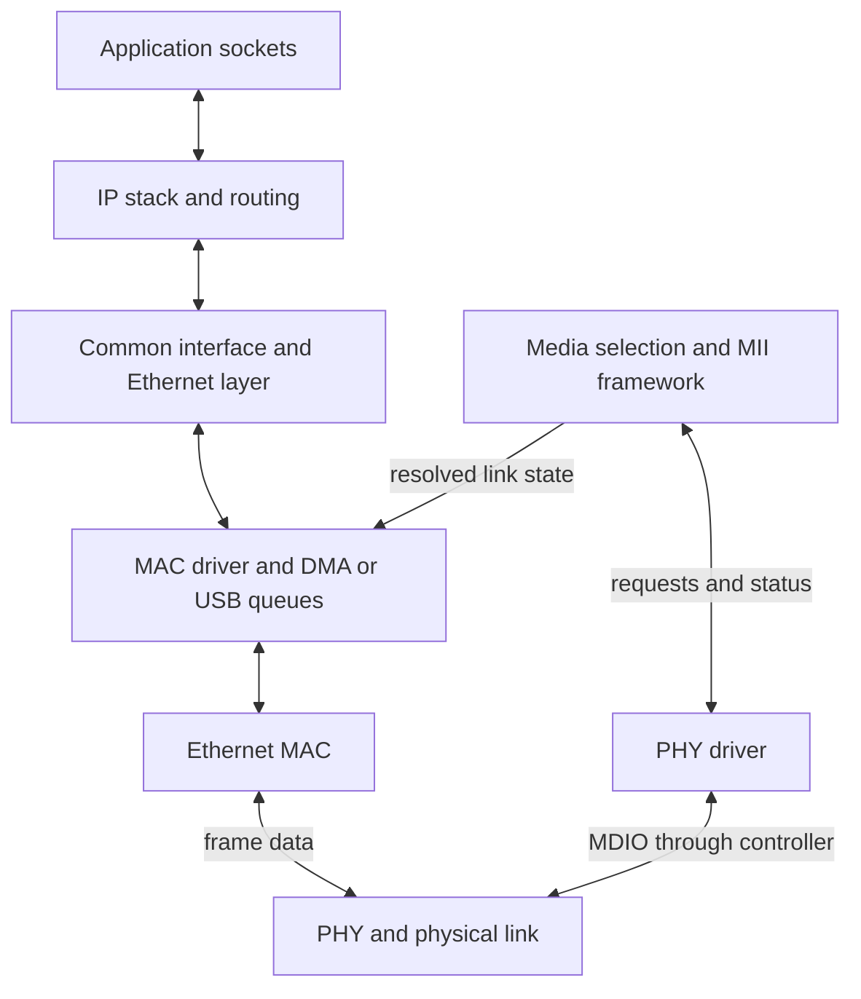

# Ethernet

[Modules](README.md) · [Networking](networking.md) · [Driver interfaces](https://github.com/oxtech-ember/EmberBSD/blob/main/sys/net/docs/ethernet.md)

An Ethernet driver moves frames between a controller and the common network stack.
It does not implement IP routing, DHCP, VLAN policy, or application protocols.
A new controller normally connects to the existing interface and Ethernet layers; a new PHY connects to the existing MII framework.
USB Ethernet devices reuse `usbnet` for their transport lifecycle.

This page explains the architecture and integration choices.
The [source interface map](https://github.com/oxtech-ember/EmberBSD/blob/main/sys/net/docs/ethernet.md) links the exact callbacks, headers, and checks.
Device models, wiring, PHY addresses, clock delays, and physical support records remain in [DevBoards](https://github.com/oxtech-ember/EmberBSD-DevBoards).

## Data and control paths

A **MAC** sends and receives Ethernet frames. A **PHY** handles the physical link and reports its negotiated state.
The MAC and PHY can be separate chips or parts of one controller.
The kernel's MII framework shares PHY discovery, media selection, and link handling across controller drivers.

MDIO is the management path used to access PHY registers; it does not carry application packets.
MII, RMII, GMII, RGMII, and serial interfaces such as SGMII describe MAC-to-PHY data connections.
These names do not describe the speed of the host bus or guarantee a particular external link mode.

This diagram shows a controller with a managed PHY.
A USB adapter can hide some link operations in firmware; a virtual NIC talks to a hypervisor instead of a physical PHY.
An internal PCS, which handles physical coding, or a fixed link may need a controller-specific media path.
Use the real topology rather than inventing an external PHY or autonegotiation mechanism.

| Module | Responsibility | What an adapter supplies |
| --- | --- | --- |
| Interface and Ethernet layer — OS | Interface lifecycle, frame dispatch, multicast membership, packet capture, common Ethernet control | Frame transport, supported capabilities, counters, and link notifications |
| IP stack and virtual interfaces — OS | Addressing, routing, ARP/IPv6 neighbor discovery, VLANs, bridging, aggregation | Ordinary Ethernet frames and accurate metadata; protocol policy stays in the common owner |
| MAC driver — OS | Descriptor rings, device queues, filters, IRQs, hardware offload, reset | Registers and device-specific operations, with explicit DMA and buffer ownership |
| MII and PHY driver — OS | Media capabilities, negotiation, status, PHY-specific programming | MDIO access from the controller; PHY service/status/reset operations from the PHY driver |
| Bus/platform attachment — OS | PCI, ACPI, FDT, USB resources, clocks, reset, power, DMA constraints | Actual device properties and resources, including the MAC address and PHY connection |
| `usbnet` — OS | Shared USB pipes, transfer chains, interface integration, locking, and teardown | Device framing, initialization, filter programming, and link/register operations |
| Network services — userland | Address assignment, authentication where required, persistent configuration | Configuration of the existing interface; no private networking stack in the driver |

## How a frame moves

On transmit, the common stack selects the interface and supplies a frame with any requested offload metadata.
The adapter maps or copies it into the device's transfer path, publishes the work, and retains the necessary resources until completion.
It then reclaims the transfer and makes room for more traffic. A full queue needs bounded backpressure or a counted drop.

On receive, the adapter validates completion status and lengths, makes device writes visible to the CPU,
and delivers a packet with accurate checksum and VLAN metadata to the common receive path.
The shared Ethernet layer dispatches it to the appropriate protocol or virtual interface.
PHY drivers do not process received packets.

Packet memory, DMA mappings, descriptors, and USB transfers have different lifetimes.
An interrupt is a reason to inspect completion state, not proof that every pending transfer has finished.
Before recycling memory, the driver must know that the device no longer owns it.
On stop, reset, or detach, it must also stop callbacks and deferred work before freeing their state.
The [owner map](https://github.com/oxtech-ember/EmberBSD/blob/main/sys/net/docs/ethernet.md#packet-ownership-and-concurrency) points to the exact memory and concurrency contracts.

## Link control and configuration

Keep four states separate: the interface is administratively enabled, the physical link is up,
network addressing is configured, and the intended peer/service is reachable.
A successful PHY negotiation does not prove DHCP, routing, or application traffic.

The PHY resolves speed, duplex, and negotiated flow control; the MAC must be programmed consistently with that result.
Media changes and link loss must reach the common interface state so that consumers can react.
Board-specific reset timing and RGMII delays come from the hardware description and attachment code.
Enabling the same delay at both ends can break a link even when discovery succeeds.

| Choice | Owner and effect |
| --- | --- |
| Controller and PHY selection | Kernel configuration and hardware description select the attachment and required drivers |
| Media and administrative state | Common interface/media controls select supported link modes and bring the interface up or down |
| MTU and offloads | Interface controls select a frame size and supported acceleration; every component in the path must accept the result |
| VLAN, bridge, or aggregation | Virtual-interface configuration composes physical links without adding those protocols to each MAC driver |
| Addresses, routes, and authentication | Userland configuration selects static addressing or services and, where needed, wired 802.1X |

Use the [network and service configuration](https://github.com/oxtech-ember/EmberBSD-Docs/blob/main/configuration/services-and-applications.md)
and the owner's [ifconfig reference](https://github.com/oxtech-ember/EmberBSD/blob/main/sbin/ifconfig/ifconfig.8) for exact configuration.
Keep installation-specific addresses and credentials outside shared documentation.

## Standards and current boundaries

The table describes mechanisms in the [reviewed source baseline](../sources.md#ethernet-review).
It is not a hardware support matrix or a claim that every controller implements every feature.

| Standard or mechanism | EmberBSD integration and limit |
| --- | --- |
| IEEE 802.3 Ethernet | The common Ethernet layer and controller/PHY drivers provide frame transport and media handling. The media vocabulary covers 10/100/1000 Mb/s, multi-gigabit, and higher-rate links; usable modes depend on the complete MAC/PHY/link path. |
| IEEE 802.3 autonegotiation and duplex | Shared MII helpers and PHY services handle supported negotiation modes. The MAC must follow the resolved result. Fixed links and firmware-managed devices need their own truthful media reporting. |
| IEEE 802.3 Clause 22 / Clause 45 management | MII provides register-access callbacks; Clause 45 register definitions and indirect MMD helpers also exist. This does not make every controller capable of native Clause 45 transactions. |
| IEEE 802.3x PAUSE | MII flow-control resolution and MAC implementations exist. Receive and transmit pause depend on the negotiated result and the adapter. PAUSE is not priority flow control or a latency guarantee. |
| IEEE 802.3az EEE | Capability and PHY register definitions exist. Actual low-power-idle behavior is driver-specific; some PHY paths explicitly disable EEE. Do not infer active EEE from a link speed or capability name. |
| IEEE 802.1Q VLANs | The common `vlan` interface handles tagging and demultiplexing; hardware tag insertion/stripping/filtering are optional. VLAN-sized frames, hardware tagging, and filtering are distinct capabilities. Priority bits do not establish traffic scheduling or TSN support. |
| Ethernet bridging and IEEE 802.1D STP | The common bridge implements forwarding and STP. This does not establish hardware switch offload, RSTP, or MSTP support. |
| IEEE 802.1AX LACP, formerly 802.3ad | The common `lagg` interface implements LACP and also offers other aggregation/failover modes. Peer configuration and member capabilities still matter; hashing traffic across members does not make one flow use every link. |
| IEEE 802.1X / EAPOL | The base supplicant includes the wired backend. Authentication methods and credentials belong to userland and the network's authentication service. This is separate from PHY negotiation and does not establish MACsec encryption. |
| USB CDC Ethernet (ECM/NCM) and VirtIO network transport | CDC Ethernet and NCM adapters use `usbnet`; vendor protocols have their own adapters. VirtIO uses its own negotiated transport features. Neither path requires a fictitious physical MII bus. |
| Jumbo frames, checksum/segmentation offload, multiple queues | Supported interfaces and driver implementations exist, with per-adapter limits. These capabilities do not follow merely from IEEE 802.3 compliance or a nominal link rate. |

For the standards' scope, see IEEE [802.3](https://standards.ieee.org/ieee/802.3/10422/),
[802.1Q](https://standards.ieee.org/ieee/802.1q/10323/), and [802.1AX](https://standards.ieee.org/ieee/802.1AX/6768/).
Implementation entry points and specific limitations are in the [owner interface map](https://github.com/oxtech-ember/EmberBSD/blob/main/sys/net/docs/ethernet.md#protocols-and-feature-selection).

PoE, hardware PTP timestamping, TSN scheduling, and MACsec need their own hardware and software contracts.
A PHY identifier, EtherType constant, or controller datasheet does not establish those complete paths.
This chapter makes no general support claim for them.

## Offload and performance

Keep available capabilities separate from enabled capabilities and from metadata on an individual packet.
A transmit checksum request asks the device to perform work; receive checksum metadata reports work actually performed.
A driver must not mark an unchecked packet as verified or strip a VLAN tag without preserving its identity for the stack.
Use common software processing when the selected path does not provide the required offload.

The ordinary Ethernet MTU is 1500 bytes. VLAN encapsulation needs additional frame space;
a jumbo-frame capability is a separate choice with limits in the adapter and every peer on the path.
DMA segment limits, alignment, address width, and ring size are also independent constraints.

Multiple queues and receive-side steering can spread work across CPUs, but add ownership and locking requirements.
A per-CPU software receive queue is not proof of hardware RSS.
Measure bidirectional traffic, small packets, drops, CPU cost, and sustained operation as well as bulk throughput.
Keep the queue count and interrupt policy in the adapter's supported configuration rather than adding a board-specific network stack.

## Adding a controller or device

1. **Identify the part being added.** Reuse a common MAC core for a new bus attachment; add a PHY driver for a new PHY;
   use `usbnet` for a USB adapter. A different board connection need not require a new packet engine.
2. **Connect discovery and link control.** Obtain real resources, address, PHY/PCS topology, clocks, and reset behavior.
   Implement media reporting before treating an attached device as a working link.
3. **Connect frame transport.** Use the common Ethernet interface, packet buffers, DMA/USB framework, and receive queues.
   Establish bounded transmit and receive operation, filter updates, statistics, and safe stop/restart.
4. **Add only implemented capabilities.** Check tagged frames, checksum/segmentation requests, MTU limits, and error paths
   before exposing their acceleration. Keep VLAN, bridge, aggregation, and authentication policy with their existing owners.
5. **Verify the composed path.** Check packet contents, both directions, link loss/recovery, repeated up/down,
   allocation failure, and supported reset/detach/suspend behavior. Then check the intended virtual interfaces and application traffic.

Start from the [driver interface map](https://github.com/oxtech-ember/EmberBSD/blob/main/sys/net/docs/ethernet.md).
Keep executable tests beside their implementation and physical applicability in DevBoards.
An interface listing, a negotiated link, and a successful ping establish different results; none alone establishes sustained performance or every advertised offload.
