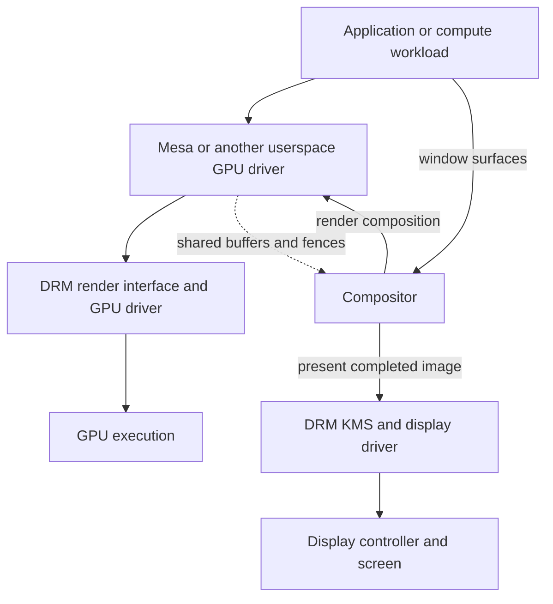

# Graphics and compute

[Modules](README.md) · [Package selection](../configuration/packages-and-sdk.md) · [Driver interfaces](https://github.com/oxtech-ember/EmberBSD/blob/main/sys/external/bsd/drm2/drm/docs/README.md)

Adding a GPU usually requires a matched kernel driver and userspace driver.
The kernel controls memory, device access, command execution, and completion.
The userspace driver implements a rendering or compute API and produces commands for that kernel interface.
A display controller is a separate consumer of image buffers; it can exist without a rendering GPU.

This page explains the boundaries and integration choices.
The [source interface map](https://github.com/oxtech-ember/EmberBSD/blob/main/sys/external/bsd/drm2/drm/docs/README.md) identifies the headers, callbacks, contracts, and checks to use.
Device models, firmware applicability, wiring, and physical support records remain in [DevBoards](https://github.com/oxtech-ember/EmberBSD-DevBoards).

## Three paths

| Path | Result | Required pieces |
| --- | --- | --- |
| Rendering | An image in memory | Application API, userspace driver, kernel GPU driver; or an explicitly selected CPU renderer |
| Display | Pixels on a screen | A completed image, a display driver, and a presentation path |
| Compute | Data in memory | A compute API/runtime and its execution backend; no display or compositor required |

DRM means Direct Rendering Manager. Its common kernel mechanisms serve GPU and display drivers.
KMS means Kernel Mode Setting: the DRM interface for connectors, display modes, planes, and scanout.
Scanout is the display controller reading an image repeatedly to drive the screen.
KMS does not compile shaders or render application content.

This shows a direct display session. An offscreen application uses only the render path.
A nested compositor presents through a host window system instead of owning KMS.
GPU and display may share a chip or be separate devices; their buffer compatibility still needs checking.

## Module responsibilities

| Module and owner | Responsibility | Boundary for a new driver |
| --- | --- | --- |
| Platform and bus support — OS | Discovery, registers, IRQs, DMA, IOMMU, clocks, power, reset | Supply actual device resources and properties; keep board wiring out of rendering libraries |
| Common DRM — OS | Device files, GEM buffer handles, sharing, fences, sync objects, scheduling helpers, KMS objects | Reuse these mechanisms; extend the common owner when an operation is missing |
| GPU adapter — OS | Device memory mappings, command validation, hardware queues, interrupts, firmware ABI, fault handling | Translate the common contract into hardware operations and report real completion |
| Display adapter — OS | Connector detection, modes, planes, scanout addresses, vblank and page flips | Advertise formats and operations that the hardware path can perform |
| libdrm — Ports | Native device discovery and userspace access to DRM interfaces | Match the kernel identity and ioctl ABI; libdrm itself is not a renderer |
| Mesa / Vulkan ICD — Ports | API implementation, shader compilation, resource layout, command generation | Use the matching kernel UAPI and common compiler/runtime code |
| Compositor / window system — Ports | Window placement, composition, frame scheduling, presentation | Negotiate buffers and synchronization with clients and display devices |
| Toolkit and application | UI drawing, workload, model loading, data preparation | Select an available backend and respect its resource lifetime |

A render node permits rendering operations subject to device-file permissions; it does not grant modesetting ownership.
A direct compositor also needs access to the primary display device and the seat/session mechanism.
Native enumeration, device-change events, input, and seat access have separate [Ports integration contracts](https://github.com/oxtech-ember/EmberBSD-Ports/blob/main/profiles/common-graphics/cross/drm-input.md).

## Standards and current boundaries

There is no single graphics API version supported by every EmberBSD device.
The available result is the intersection of the selected package, userspace driver, kernel interface, and hardware.
The table describes the [reviewed source baseline](../sources.md#graphics-and-compute-review), not a hardware support list or conformance certification.

| Interface or standard | Role and current boundary |
| --- | --- |
| DRM/KMS, including atomic modesetting | Present in the kernel stack. Each display driver supplies its supported objects and operations. Atomic state checking does not imply support for every mode, plane, modifier, or display feature. |
| GEM, PRIME / DMA-BUF | Buffer allocation, handles, and cross-component sharing exist. Export, foreign import, CPU mapping, and scanout are separate capabilities; a driver may implement only a subset. |
| DRM sync objects, timelines, sync-file fences | Common binary and timeline mechanisms exist; drivers opt in. A usable path requires fences tied to real device completion. The native DMA-BUF sync-file ioctls do not implement `DMA_BUF_IOCTL_SYNC` or CPU cache maintenance. |
| OpenGL and OpenGL ES | Enabled in the ordinary shared Mesa recipe. The selected driver determines API versions, profiles, and extensions. CPU renderers are separate choices, not evidence of GPU execution. |
| EGL and GBM | EGL connects client rendering APIs to supported native platforms; GBM manages graphics buffers. Both are in the shared Mesa build. Neither alone establishes a compositor, a working importer, or display output. |
| Vulkan and SPIR-V | Ports provides the loader, headers, and selected Mesa ICDs. The ICD implements Vulkan and translates shader input for its GPU. Query the physical device's API version, features, limits, formats, and extensions; the headers' version is not the device's version. |
| Vulkan WSI | Window presentation requires surface and swapchain support for the chosen platform. Headless compute and offscreen rendering can work without it. The current Qt bsdfb offscreen profile deliberately provides no Vulkan window surface or swapchain. |
| Wayland and X11 | Userspace window-system choices in Ports. Client rendering, compositor rendering, display access, and input each need their own integration. Installing a desktop package set does not establish a working session. |
| HDMI / DisplayPort and EDID | Belong to the display adapter and link hardware. Connector naming or EDID parsing alone does not establish a link version, audio, HDR, VRR, or hotplug support. Consult the implementation and DevBoards for the selected path. |
| OpenCL, video APIs, and NPU runtimes | Separate from 3D rendering. The reviewed Mesa recipe disables Rusticl OpenCL and the Teflon NPU delegate. VA-API is enabled for selected video backends in the full recipe; codecs, encode/decode, and Vulkan Video require their own driver/runtime evidence. |

The exact build selection is in [MesaLib's recipe](https://github.com/oxtech-ember/EmberBSD-Ports/blob/main/pkgsrc/graphics/MesaLib/Makefile) and [options](https://github.com/oxtech-ember/EmberBSD-Ports/blob/main/pkgsrc/graphics/MesaLib/options.mk).
For API semantics, read the upstream [Mesa API map](https://docs.mesa3d.org/systems.html), [EGL description](https://docs.mesa3d.org/egl.html),
[Vulkan loader](https://docs.vulkan.org/guide/latest/loader.html), [feature selection](https://docs.vulkan.org/guide/latest/enabling_features.html), and [WSI](https://docs.vulkan.org/guide/latest/wsi.html).
Upstream support does not by itself establish EmberBSD integration.

Zink implements OpenGL through Vulkan. It can reuse an existing Vulkan driver instead of adding another hardware OpenGL backend,
but its usable OpenGL level depends on the underlying Vulkan features and limits.
See [Zink requirements](https://docs.mesa3d.org/drivers/zink.html) and the [Ports integration](https://github.com/oxtech-ember/EmberBSD-Ports/blob/main/profiles/common-graphics/cross/zink.md).

Virtual graphics also needs both sides of its protocol: a guest kernel/userspace driver and a compatible host renderer.
A Mesa VirGL build does not enable guest 3D by itself. The current native [VirtGPU integration](https://github.com/oxtech-ember/EmberBSD/blob/main/sys/external/bsd/drm2/virtio/README.md) documents its experimental 2D boundary and disabled optional features.

## Buffers connect the modules

A shared buffer needs more than a file descriptor.
Producer and consumer must agree on pixel format, plane layout, stride, offsets, and modifier.
A modifier describes storage layout, such as tiling or compression; a linear-only display cannot scan out an arbitrary tiled render target.
Import also depends on addressability and mapping support. The native CMA helper currently accepts a single contiguous DMA segment;
other memory backends have their own constraints. See the [import contract](https://github.com/oxtech-ember/EmberBSD/blob/main/sys/external/bsd/drm2/drm/docs/drm-cma-import.md).

Three questions must be answered separately:

1. **Who retains the memory?** Handles, exported descriptors, CPU mappings, GPU mappings, and queued work can have different lifetimes.
2. **When may the next consumer use it?** A fence records completion. Sharing memory does not supply a missing dependency or a release event.
3. **When are writes visible?** Cache maintenance and device memory ordering remain necessary even when a fence has signaled.

The renderer retains its resources until execution ends. A display path retains a scanout buffer until it is no longer being read.
Applications and compositors must wait for the relevant release before recycling buffers.
Import/export, explicit fences, and implicit reservation dependencies must form one consistent ownership path;
support for one part does not establish the whole path. Exact rules live in the [DMA-BUF synchronization contract](https://github.com/oxtech-ember/EmberBSD/blob/main/sys/external/bsd/drm2/drm/docs/drm-dmabuf-sync.md).

After a timeout, an error fence alone does not prove that DMA stopped.
The driver must establish completion or isolation before releasing device-visible memory; otherwise it must retain that memory under its documented failure policy.
Scheduler cancellation and hardware reset are different operations. Read the [submission contract](https://github.com/oxtech-ember/EmberBSD/blob/main/sys/external/bsd/drm2/drm/docs/drm-submit.md) before adding a queue.

## Accelerating an interface

The application and compositor can use different rendering backends.
A GPU-rendered application can still incur CPU readback or composition; a GPU compositor can also display CPU-rendered client buffers.
Check each stage instead of treating a visible window as proof of acceleration.

| Composition choice | Data path | Consequence |
| --- | --- | --- |
| Direct GPU display | Render into compatible buffers, synchronize, then present through KMS | Requires working import, formats/modifiers, fences, and display lifetime |
| GPU offscreen + framebuffer copy | Render on the GPU, wait, read pixels, copy them into the framebuffer | Can accelerate drawing while retaining readback and CPU-copy costs |
| CPU rendering | Rasterize on the CPU, then present the image | Useful as an explicit recovery or bring-up choice; does not test the GPU |

The [Qt bsdfb Vulkan offscreen profile](https://github.com/oxtech-ember/EmberBSD-Ports/blob/main/profiles/common-graphics/cross/qt-bsdfb-vulkan-offscreen.md) implements the second kind of path.
It must not be described as GPU scanout. A direct KMS path needs a separate presentation backend.
Keep toolkit selection, rendering API, and window-system backend explicit when configuring a UI.

Measure the selected renderer, completion, frame pacing, CPU copies, and retained memory under the intended workload.
An offscreen frame rate does not measure physical presentation; a nested compositor does not test device takeover or hotplug.
Use the existing [UI measurement procedure](https://github.com/oxtech-ember/EmberBSD-Ports/blob/main/profiles/common-graphics/cross/ui-performance.md) and [Qt/KWin example](https://github.com/oxtech-ember/EmberBSD-Examples/tree/main/desktop/kwin-frame-check).

## Adding a GPU or accelerator

1. **Choose the first result.** Display-only, offscreen rendering, compute, and an accelerated desktop need different closures of the stack.
   Start with one operation whose output can be checked.
2. **Choose a matched kernel/userspace pair.** Find the existing upstream driver and its UAPI, firmware ABI, shader compiler, and required capabilities.
   The same GPU family name does not make incompatible kernel interfaces interchangeable.
   In particular, a vendor Services interface and an upstream DRM interface require their matching userspace drivers.
3. **Connect the kernel adapter.** Reuse common memory, synchronization, scheduler, and display mechanisms.
   Keep registers, firmware command encoding, device validation, DMA, and recovery in the adapter.
   Use the [driver interface map](https://github.com/oxtech-ember/EmberBSD/blob/main/sys/external/bsd/drm2/drm/docs/README.md) to locate each extension point.
4. **Connect userspace in Ports.** Extend the shared recipe and patches, including native device discovery, target ABI, and cross-build generators.
   Keep API state tracking and shader compilation out of the kernel. Advertise only implemented features.
5. **Join the consumers.** For a UI, add buffer exchange and presentation after offscreen execution works.
   For compute, connect the runtime and check numerical results, completion, and memory reuse without requiring a display.
6. **Check failure and steady operation.** Cover rejected requests, partial initialization, close while work is pending, allocation failure, timeouts, and the supported recovery path.
   Then test the intended application. Keep executable checks with the owner and hardware applicability in DevBoards.

A new compute-only adapter does not need fake KMS objects or a desktop stack.
Use a supported GPU compute API where it fits; a dedicated accelerator needs its actual userspace runtime and execution contract.
Model parsing, graph lowering, tensor preparation, and reference results belong to that runtime or its tests.
Read [NPU and inference acceleration](npu.md) for runtime/provider boundaries, model formats, numerical correctness,
and the limits of the current fixed native task.
CPU inference and model services remain independent choices; see the [local inference example](https://github.com/oxtech-ember/EmberBSD-Examples/tree/main/ai/local-inference).

## Read next

- [Kernel and userspace driver interface map](https://github.com/oxtech-ember/EmberBSD/blob/main/sys/external/bsd/drm2/drm/docs/README.md)
- [Ports graphics integration](https://github.com/oxtech-ember/EmberBSD-Ports/tree/main/profiles/common-graphics)
- [Kernel and hardware configuration](../configuration/kernel-and-hardware.md), [package selection](../configuration/packages-and-sdk.md)
- [DevBoards](https://github.com/oxtech-ember/EmberBSD-DevBoards) for hardware selection and support evidence
