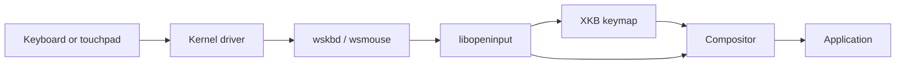

# Input devices and key mapping

[Guide](../README.md) · [Modules](README.md) · [Configuration](../configuration/README.md)

This page explains how keyboard, touchpad and pointer events reach an application.
It also shows which layer to change when a key or a touchpad does not do what you expect.
Exact interfaces, file formats and tests stay with their owners, which the page links.

## The input path

Each layer has one responsibility. A layer does not repair a fault of the layer below it.

| Layer | Responsibility | Owner |
| --- | --- | --- |
| Device drivers | Read the hardware and decode its reports: PC keyboards, USB HID keyboards, Precision Touchpads over I2C, Bluetooth HID | EmberBSD kernel |
| wscons | Give one event interface for keyboards (`wskbd`) and pointers (`wsmouse`), including touchpad gestures | EmberBSD kernel ([`wsconsio.h`](https://github.com/oxtech-ember/EmberBSD/blob/main/sys/dev/wscons/wsconsio.h)) |
| libopeninput | Give the libinput API on wscons: change wscons events to evdev key codes, pointer motion and gesture events | Ports ([`devel/libopeninput`](https://github.com/oxtech-ember/EmberBSD-Ports/tree/main/pkgsrc/devel/libopeninput)) |
| XKB | Change key codes to symbols and actions with the selected layout and options | Ports ([`x11/xkeyboard-config`](https://github.com/oxtech-ember/EmberBSD-Ports/tree/main/pkgsrc/x11/xkeyboard-config)), libxkbcommon |
| Compositor | Read devices through libinput, apply the session settings and send events to applications | Ports (for example KWin in the Plasma package set) |

The compositor is optional. An embedded application can read `wsmouse` directly.
The [Runtime page](runtime.md) describes that path for touch devices.

## How a key gets its meaning

A key press goes through three numbers. Each number has a different owner.

1. **Scan code.** The keyboard sends it. A PC (AT) keyboard sends one byte.
   An escaped key sends `e0` and then the byte. wscons gives the escaped key a
   key number with bit 7 set: `e0 11` becomes `0x91`.
2. **Key code.** libopeninput changes the wscons key number to an evdev key code,
   for example `KEY_MUTE`. PC keyboards and USB keyboards use different tables.
3. **Symbol.** XKB changes the key code to a symbol, for example `XF86AudioMute`.
   The layout and its options select the symbol. The compositor then does the action.

A key that gives no symbol can fail at any of these steps.
Find the first step that gives a wrong result, then change that layer only.

## Vendor scan codes

Many laptops send vendor scan codes for media and Fn keys.
The plain PC keyboard table does not know them.
On Linux, udev maps these codes with the `KEYBOARD_KEY_` records of the
[systemd hardware database (hwdb)](https://www.freedesktop.org/software/systemd/man/latest/hwdb.html).
The DMI strings of the system select the records.

EmberBSD has no udev hwdb. libopeninput reads the same record format itself:

- It makes the Linux DMI modalias from `sysctl machdep.dmi`.
  An unknown DMI field is empty, so that the Linux patterns also match on a system
  that knows fewer fields.
- It reads the `*.hwdb` files of the package directory and then of the local
  directory, in name order. A later record replaces an earlier one.
- It applies the matching records to the table of the PC keyboards only.
  USB keyboards send HID usages and do not use these records.

The package installs `60-keyboard.hwdb` of systemd, which has the records that Linux uses,
and `70-emberbsd-keyboard.hwdb`, which has the EmberBSD changes.
The EmberBSD file explains each change, for example why an MSI microphone key keeps `KEY_F20`.
Put local records in the local directory: a package update replaces the package files.
libopeninput reads the files once per process, so restart the compositor after a change.
The [recipe](https://github.com/oxtech-ember/EmberBSD-Ports/tree/main/pkgsrc/devel/libopeninput)
has the file paths, the parser in `files/wskbd-hwdb.c`, the EmberBSD records and the test
`tests/keyboard-hwdb.sh`.

The records change the key code only. They cannot help in these cases:

- **The key sends nothing to the system.** The firmware handles some Fn keys itself.
- **The key reaches the system through ACPI.** Such hotkeys need a kernel driver.
- **The key code is above 247.** Its XKB key code is above 255. Wayland clients get it.
  X11 clients, also under XWayland, do not. Linux has the same limit.

## Layout options for function rows

Some laptops send F1–F12 without Fn and the printed actions with Fn, and have no Fn lock.
The `fnmedia` options of `xkeyboard-config` swap these two layers for one laptop model.
The option changes symbols, not key codes. It needs the key codes of the layer below,
so the option of a model and the hwdb records of that model must agree.
The [symbols file](https://github.com/oxtech-ember/EmberBSD-Ports/blob/main/pkgsrc/x11/xkeyboard-config/files/symbols/fnmedia)
lists the variants and the keys of each model that send no event.
Select the option in the session keyboard settings, together with the layout.

## Touchpads

The kernel driver of a Precision Touchpad decodes contacts and decides taps, clicks, drag and gestures.
It sends pointer events and gesture events (swipe, pinch) through `wsmouse`.
libopeninput declares gesture support only for a device that reports it.
Driver settings, such as tapping and gestures, are `sysctl` nodes of the driver instance.
The compositor can switch a pointer device off through libinput.
The driver sources and their contract tests define the exact behavior:
[contact policy tests](https://github.com/oxtech-ember/EmberBSD/blob/main/sys/dev/hid/tests/README.hidmt.md),
[I2C adapter tests](https://github.com/oxtech-ember/EmberBSD/blob/main/sys/dev/i2c/tests/README.imt.md)
and an [example of laptop touchpad discovery](https://github.com/oxtech-ember/EmberBSD/blob/main/sys/dev/acpi/docs/arrowlake-touchpad.md).

## Choose the layer to change

| Symptom | Layer | Change |
| --- | --- | --- |
| No device node, or the device does not attach | Kernel driver | Driver or hardware description in EmberBSD; hardware record in DevBoards |
| A key gives a wrong key code or `KEY_RESERVED` | libopeninput | A hwdb record in the local directory, or in the EmberBSD file of the recipe for all users |
| The key code is right, but the symbol or the Fn layer is wrong | XKB | A layout option in `xkeyboard-config` |
| The key sends nothing, or reaches the system through ACPI | Firmware or kernel | A kernel driver for the hotkey interface, if the hardware allows it |
| Taps, drag or gestures do not behave as expected | Kernel touchpad driver | Driver settings, or a driver change with its contract tests |
| The device works, but the session ignores it | Compositor | Session input settings |

## Current limits

The hwdb mapping is in the Ports recipe from `libopeninput-1.31.3nb10`.
Earlier packages have a fixed table for a few MSI keys and no hwdb files.
A built package does not prove that a laptop's keys work.
Record the physical result of a model in DevBoards.
libopeninput applies only `KEYBOARD_KEY_` records. It ignores the other hwdb properties,
such as LED and fixed-layout properties, and records for devices other than PC keyboards.
