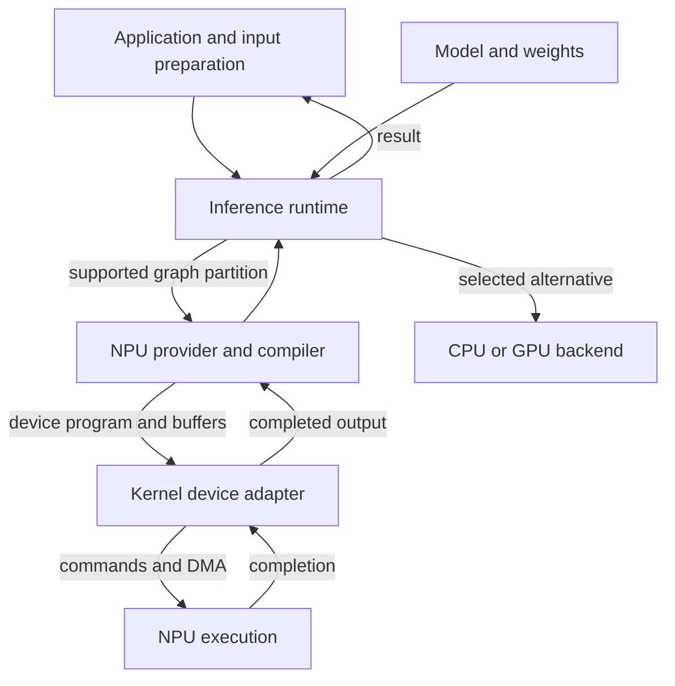

# NPU and inference acceleration

[Modules](README.md) · [GPU compute](graphics-and-compute.md) · [Integration interfaces](https://github.com/oxtech-ember/EmberBSD/blob/main/sys/arch/arm/sunxi/docs/npu-integration.md)

An NPU executes selected neural-network operations. A usable inference path also needs a model loader,
a compiler or execution provider, memory management, and a matching device driver.
A model format, a runtime API, and a hardware command ABI are different interfaces.

**Current boundary:** EmberBSD has a native fixed NN task and runtime/source integrations at different stages.
The native task accepts no user model, tensor, or command stream. It is not a general NPU runtime.
The [owner interface map](https://github.com/oxtech-ember/EmberBSD/blob/main/sys/arch/arm/sunxi/docs/npu-integration.md) distinguishes existing entry points from work needed for a new backend.
Device models, wiring, firmware applicability, and physical support records remain in [DevBoards](https://github.com/oxtech-ember/EmberBSD-DevBoards).

## Architecture

The normal inference architecture separates application policy, graph preparation, execution, and hardware access.
This diagram describes those responsibilities; it does not claim that the complete NPU path is available today.

A runtime loads the graph and assigns supported operations to an execution backend.
A compiler lowers those operations into the selected device's program and storage layout.
Preparation can happen ahead of time on the development host or during runtime initialization.
The choice changes deployment size, startup time, and the tools required on the device.
It does not remove the need to match the compiled program to the device and driver.
See the upstream [LiteRT compilation overview](https://developers.google.com/edge/litert/next/npu).

| Module and owner | Responsibility | Boundary for a new adapter |
| --- | --- | --- |
| Application / example | Input normalization, model selection, output interpretation, quality criteria | Supplies model assets and meaningful test cases |
| Inference runtime — Ports | Model loading, graph execution, backend selection, application-facing API | Keeps graph policy and any permitted CPU/GPU fallback in userland |
| Provider / delegate and compiler — Ports | Supported subgraphs, operator lowering, layout conversion, device-program preparation | Matches operator semantics and the device execution ABI |
| Device userspace library — Ports | Device discovery, buffer bindings, submission and result handling | Uses the actual kernel contract; loading a shared library is not device execution |
| Kernel adapter — OS | Request validation, memory mappings, device queues, IRQs, completion, isolation and recovery | Contains registers, hardware command encoding where required, firmware protocol, and chip-specific limits |
| Platform and bus support — OS | Discovery, DMA constraints, clocks, reset, power and interrupts | Supplies resources without taking ownership from other accelerator consumers |

The inference runtime here is a library such as ONNX Runtime or LiteRT.
It is separate from the planned [EmberBSD application Runtime](runtime.md).
An NPU does not require a window system, display controller, or desktop stack.

## What exists now

| Path | Current implementation boundary |
| --- | --- |
| [Native NN task](https://github.com/oxtech-ember/EmberBSD/blob/main/sys/arch/arm/sunxi/docs/a733-npu-tiny-task.md) | One trusted fixed INT8 workload, with owned DMA/MMU state and checked completion/output. No arbitrary model upload, reusable application session, or general tensor-result API. |
| [VIPLite diagnostic subset](https://github.com/oxtech-ember/EmberBSD/blob/main/sys/arch/arm/sunxi/docs/a733-npu-vip.md) | Identification, software handshake, and bounded register reads under the documented conditions. Memory, cache, and task commands are unsupported. |
| [Compass userspace probe](https://github.com/oxtech-ember/EmberBSD-Ports/blob/main/probes/compass-umd/README.md) | Source adaptation and a full userspace-library build with no-device API checks. Native kernel transport and model execution remain unavailable. |
| [ONNX Runtime recipe](https://github.com/oxtech-ember/EmberBSD-Ports/tree/main/pkgsrc/local-ai/onnxruntime) | CPU execution and a selectable WebGPU provider through Dawn/Vulkan; the recipe suggests WebGPU. This does not supply a native NPU provider. |
| [LiteRT source package](https://github.com/oxtech-ember/EmberBSD-Ports/blob/main/pkgsrc/devel/litert/Makefile) and [CPU profile](https://github.com/oxtech-ember/EmberBSD-Ports/blob/main/probes/litert/README.md) | The package supplies shared source. The separate CPU runtime profile excludes GPU/NPU. The [LiteRT-LM probe](https://github.com/oxtech-ember/EmberBSD-Ports/blob/main/probes/litert-lm/README.md) also disables NPU execution. |
| [Mesa Teflon](https://github.com/oxtech-ember/EmberBSD-Ports/blob/main/pkgsrc/graphics/MesaLib/Makefile) | Disabled in the reviewed recipe. An upstream NPU delegate is not an enabled EmberBSD backend. |
| [openTPU tools](https://github.com/oxtech-ember/EmberBSD-Ports/blob/main/pkgsrc/local-ai/py-opentpu/DESCR) | ISA simulator, compiler, kernels and host tools. The package does not enable hardware support. |

The [source baseline](../sources.md#npu-review) records the revisions behind this table.
For the fixed task, model preparation and the CPU oracle run in a host fixture generator.
The kernel consumes a generated immutable image and retains expected bytes for its existing result comparison;
it does not parse a model or evaluate the CPU network. This is a diagnostic boundary, not the application runtime design.
See the [fixture contract](https://github.com/oxtech-ember/EmberBSD/blob/main/sys/arch/arm/sunxi/docs/a733-npu-nn.md).

## Formats, APIs, and standards

There is no single portable NPU command ABI in the reviewed stack.
Support must be stated for each layer, including the operations and shapes used by the model.

| Interface or technology | Meaning and current limit |
| --- | --- |
| ONNX IR, domains, and opsets | Describe a model and versioned operator semantics. The runtime and provider must support the required operators, attributes, shapes, and types. An ONNX file is not an NPU executable; the native fixed task has no ONNX loader. |
| LiteRT / TensorFlow Lite `.tflite` | A model container with operator versions and tensor metadata. Delegate or compiler/dispatch integration supplies acceleration. The reviewed EmberBSD CPU profile does not provide that NPU path. |
| ONNX Runtime execution-provider API | A userland extension point for assigning and executing supported graph regions. Upstream has a plugin API for new providers; it is not a kernel driver interface or proof of an installed NPU provider. |
| LiteRT accelerator interfaces | Upstream provides compiler and dispatch interfaces, as well as the Interpreter delegate path. A matching device runtime and native transport still need integration. |
| Quantized integer and floating-point tensors | Precision, signedness, scale, zero point, layout and accumulation rules affect correctness. The fixed native INT8 task proves only its defined operation and encoding, not general INT8, FP16, BF16 or INT4 model support. |
| Vendor compiled artifacts, including NBG and Compass programs | Depend on compiler output format, hardware revision, capabilities and the matching kernel/userspace pair. A vendor name or filename extension does not establish compatibility; the native fixed task is not a general artifact loader. |
| Teflon / Gallium | Upstream Mesa can implement a TensorFlow Lite delegate through selected NPU backends. EmberBSD's reviewed Mesa selection disables Teflon and does not enable those backends. |
| Vulkan, SPIR-V, OpenCL and WebGPU | Separate compute APIs or shader formats. They can serve suitable GPU inference backends; they do not imply access to a dedicated NPU. The reviewed Mesa recipe also disables Rusticl OpenCL. |
| DMA-BUF and fence sharing | Existing DRM mechanisms have their own importer/exporter and completion contracts. The native NPU task exposes no shared-buffer or fence API to applications. |

Read the upstream [ONNX versioning rules](https://onnx.ai/onnx/repo-docs/Versioning.html),
[execution-provider model](https://onnxruntime.ai/docs/execution-providers/),
[LiteRT NPU integration](https://developers.google.com/edge/litert/next/npu), and [Teflon description](https://docs.mesa3d.org/teflon.html)
for those interfaces. They describe upstream mechanisms, not EmberBSD hardware acceptance.
Exact integration entry points are linked from the [owner map](https://github.com/oxtech-ember/EmberBSD/blob/main/sys/arch/arm/sunxi/docs/npu-integration.md#userspace-integration).

## Operator support and numerical correctness

An operator name alone is insufficient. A backend may support a convolution only for certain shapes,
strides, layouts, padding, quantization parameters, or constant weights.
Dynamic dimensions and custom operators need explicit support.
Reject an unsupported combination before submission, or let the runtime select a declared alternative backend.
Report which graph regions actually ran on each device.

Quantization maps stored integers to real values using a scale and zero point.
Per-tensor and per-channel scales are different contracts. Repacking weights or converting between NCHW and NHWC
must preserve the model's semantics; accumulator width, rounding and saturation can change results.
The [LiteRT quantization specification](https://developers.google.com/edge/litert/conversion/tensorflow/quantization/quantization_spec)
defines its operator-specific requirements. It does not establish conformance of the fixed native fixture.

Compare outputs with an independent CPU reference using the selected format's exactness or a justified tolerance.
Then evaluate application quality on representative inputs.
A transport interrupt, a completed command stream, and a correct model result are separate observations.

## Memory and execution

A tensor's logical dimensions do not describe its complete device storage.
The backend must agree with the adapter on layout, padding, alignment, strides, memory rights and addressability.
CPU virtual addresses, DMA addresses, and NPU virtual addresses must remain distinct.
Shared buffers also need explicit ownership, supported import/export directions, and completion ordering.
A fence does not perform missing cache maintenance.

The submitting context must retain commands, weights, input/output storage and page tables while the device can access them.
Timeout or process exit is not proof that DMA stopped.
Before reuse or release, the adapter needs verified completion or device isolation.
Reset and cancellation must have documented effects on outstanding jobs and shared resources.

The current native task is stricter: once publication is attempted, it retains its context and hardware-visible assets until reboot,
including after success or failure. It has no accepted reset/retry/release path for published work.
Its MMU guard entries have source checks; hardware guard-fault behavior is not established by those checks.
Use the [task contract](https://github.com/oxtech-ember/EmberBSD/blob/main/sys/arch/arm/sunxi/docs/a733-npu-tiny-task.md)
and [MMU contract](https://github.com/oxtech-ember/EmberBSD/blob/main/sys/arch/arm/sunxi/docs/a733-npu-mmu.md) for the exact limits.

## Adding an NPU or runtime backend

1. **Choose one observable operation and its consumer.** Start with known inputs and an independent result.
   Select the runtime/provider and the real hardware ABI together; do not start by inventing a universal model ioctl.
2. **Match the compiler, device library, kernel adapter and firmware where used.** Check the complete target identity and capabilities.
   A successful Linux demonstration or userspace cross-build is an input to the port, not an EmberBSD execution result.
3. **Connect resources and bounded execution.** Reuse native bus, DMA, interrupt and power mechanisms.
   Keep device command validation, mapping and completion rules at their owner. Extract shared mechanisms before adding another consumer.
4. **Add a usable application contract.** Define object ownership, queries, supported work, submission/completion and failure behavior.
   The existing fixed task does not provide this contract; extend the implementation and its tests before connecting a provider.
5. **Integrate graph execution in Ports.** Implement provider/delegate capability selection and compilation/dispatch with the shared runtime recipes.
   Keep model parsing, quantization and application preprocessing outside the kernel. Document any CPU/GPU partition explicitly.
6. **Verify correctness and cost.** Check unsupported inputs, memory bounds, stale completions, timeout and supported teardown.
   Then measure the complete application path, including conversion, copies, compilation, CPU work and output processing.

Keep the first implementation small, but do not treat a one-shot trusted test as safe arbitrary submission.
A sustained inference loop also needs buffer reuse, concurrency policy and failure recovery.
TOPS and a kernel-only execution time do not measure application latency, memory use or energy.

## Read next

- [Native interfaces, runtime extension points, and checks](https://github.com/oxtech-ember/EmberBSD/blob/main/sys/arch/arm/sunxi/docs/npu-integration.md)
- [GPU compute and shared-buffer boundaries](graphics-and-compute.md)
- [Package and SDK selection](../configuration/packages-and-sdk.md)
- [DevBoards](https://github.com/oxtech-ember/EmberBSD-DevBoards) for device applicability and physical results
