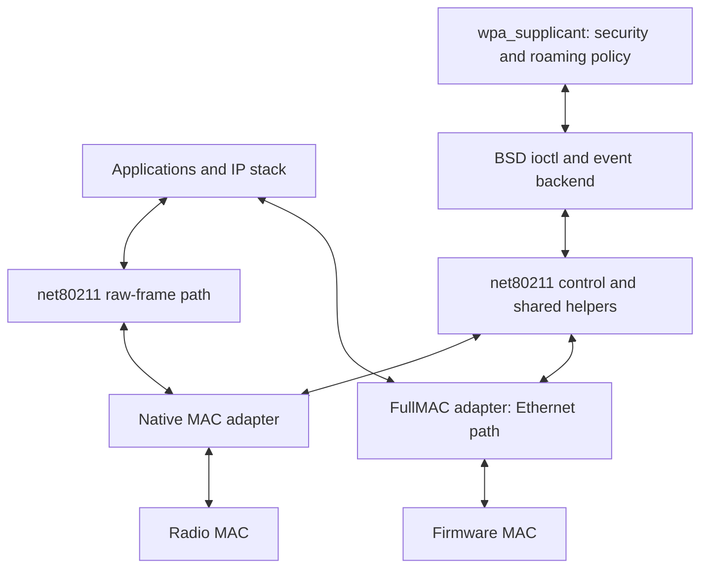

# Wi-Fi: stack, protocols, and driver boundaries

[Networking](networking.md) · [Modules](README.md) · [Driver integration](https://github.com/oxtech-ember/EmberBSD/blob/main/sys/net80211/docs/README.md)

EmberBSD uses net80211 for wireless interface control and shared protocol mechanisms.
A driver connects that stack to a radio. It does not own a second supplicant or a private copy of common protocol algorithms.
This page describes station mode: a device joining an access point (AP).
AP, monitor, IBSS, and mesh modes require their own driver paths and checks.

Hardware models, firmware applicability, wiring, and physical acceptance belong to
[DevBoards](https://github.com/oxtech-ember/EmberBSD-DevBoards/blob/main/docs/reader-guide.md).
This page describes software boundaries, not a second hardware support catalog.

## Two data paths, one BSD control interface

MAC means medium access control: the wireless link's frame and access operations.

**Native MAC:** the host sends and receives 802.11 frames.
net80211 handles frame construction, association state, and the enabled host protocol mechanisms.
The adapter programs the radio and moves frames through its bus and queues.

**FullMAC:** firmware handles association and much of the MAC data path.
The host data interface usually carries Ethernet frames.
The adapter translates common requests into firmware commands and reports their results.
Selected management frames still reach the host supplicant for SAE or roaming.

PCIe, SDIO, and USB are transports. They do not determine which MAC model a device uses.
Crypto offload is a separate choice: a native adapter can use authenticated hardware RX while retaining host TX protection.

The two net80211 boxes show responsibilities inside the same subsystem.
They are not separate network stacks or independently loadable services.
The FullMAC data path does not pass Ethernet payload through the raw-frame decoder.

## Who owns each operation

| Operation | Owner | Driver responsibility |
| --- | --- | --- |
| Network selection, credentials, SAE exchange, EAPOL key handshake | `wpa_supplicant` through its BSD backend | Transport required frames and events; apply the selected association and keys |
| Scan cache, station selection identity, ioctl validation | net80211 | Report observations and completion; reject stale firmware work |
| Raw association frames, WME negotiation, bounded HT/VHT negotiation | Native net80211 path | Supply qualified capabilities; apply channel, rate, power, and queue settings |
| Firmware association | Firmware and its adapter | Translate the selected request; report actual association IEs and link events |
| CCMP, protected management, replay checks | Host net80211 or explicitly selected firmware/hardware owner | Preserve the chosen ownership and key lifetime; report trusted hardware results |
| BlockAck windows and packet ordering | Shared net80211 mechanisms | Supply scheduling or firmware session metadata; implement hardware BlockAck operations |
| Registers, IRQ, DMA, firmware messages | Driver and bus attachment | Own buffers, command acknowledgements, reset, cancellation, and hardware drain |
| Power, reset, bus wiring, device properties | Platform description and providers | Consume properties instead of testing board names in protocol code |
| IP addresses and routes | Network configuration, such as dhcpcd | Expose a usable network interface; no DHCP logic in the radio driver |

Each key, replay counter, pending command, and retained packet needs one owner.
For example, FullMAC firmware can authenticate and decrypt data while the shared host reorder mechanism orders its output.
That does not authorize the host to reconstruct missing key or session identity from the latest connection.
The [offload receiver contract](https://github.com/oxtech-ember/EmberBSD/blob/main/sys/net80211/docs/net80211-rxba.md#firmware-offload-receiver)
defines that boundary.

## A connection from scan to stop

1. **Discover.** Collect beacon/probe information elements (IEs). An AP advertising HT, VHT, or SAE is a candidate, not an enabled local capability.
2. **Select and authenticate.** Bind work to the selected BSS and its association identity. The supplicant performs the selected authentication protocol.
3. **Associate.** The native stack or firmware negotiates with the AP. Only a matching result can enable the negotiated features.
4. **Install keys and authorize data.** The EAPOL handshake installs keys. The controlled port admits ordinary data only after the security path is ready. Association alone is insufficient.
5. **Run, rekey, or leave.** Check asynchronous events against their connection and operation identities. Retire the old session before reset or replacement; drain queues before freeing their owner.

Three identities solve different problems: association identity selects a BSS lifetime; key generation identifies a security lifetime;
an operation cookie identifies one asynchronous request. Reconnecting to the same BSSID does not revive old work.
See the [association lifecycle](https://github.com/oxtech-ember/EmberBSD/blob/main/sys/net80211/association-lifecycle.md)
and [SAE lifetime contract](https://github.com/oxtech-ember/EmberBSD/blob/main/sys/net80211/docs/sae.md).

## Standards: what the software provides

This is a map of implemented mechanisms and their limits, not a certification claim.
The [reviewed source revision](../sources.md#wi-fi-review) fixes the scope of these statements.
An adapter must supply the missing hardware operations before it advertises a feature.

| Standard or feature | Current software boundary | Detailed owner |
| --- | --- | --- |
| 802.11a/b/g | Native legacy rates, scanning, authentication, association, and data framing. The adapter supplies usable bands, channels, rates, and radio operations. | [Core and driver entry points](https://github.com/oxtech-ember/EmberBSD/blob/main/sys/net80211/docs/README.md#base-interface) |
| 802.11e / WME-WMM QoS | Shared STA negotiation, traffic classification, and queue parameters. A strict native provider applies the complete parameter set before enabling QoS. | [WME](https://github.com/oxtech-ember/EmberBSD/blob/main/sys/net80211/docs/net80211-wme.md) |
| 802.11n / HT | Bounded native STA HT20 admission on 5 GHz, with provider checks for radio, power, protection, scheduling, reorder, and A-MSDU. FullMAC has its own firmware-qualified profile. This is not all HT modes. | [HT admission](https://github.com/oxtech-ember/EmberBSD/blob/main/sys/net80211/ieee80211_ht20.h), [aggregation](https://github.com/oxtech-ember/EmberBSD/blob/main/sys/net80211/docs/net80211-rxba.md) |
| 802.11ac / VHT | Shared IE decoding and bounded native 40/80 MHz negotiation; native use requires an explicit experimental provider. FullMAC enables VHT through its firmware contract. No general 160 MHz or 80+80 claim. | [VHT contract](https://github.com/oxtech-ember/EmberBSD/blob/main/sys/net80211/docs/net80211-vht-ies.md), [native provider](https://github.com/oxtech-ember/EmberBSD/blob/main/sys/dev/ic/docs/rtl8822ce-wifi5-experiment.md), [FullMAC example](https://github.com/oxtech-ember/EmberBSD/blob/main/sys/dev/sdmmc/docs/aicwf-vht.md) |
| 802.11i / RSN (WPA2) | Supplicant key management and driver-selected ciphers; CCMP is the baseline for the modern station paths described here. | [Crypto](https://github.com/oxtech-ember/EmberBSD/blob/main/sys/net80211/docs/net80211-crypto.md) |
| WPA3-Personal / SAE and 802.11w PMF | Host SAE/EAPOL with a selected CCMP, required-PMF, BIP-CMAC-128 profile. Native and FullMAC use different key/crypto lifetimes. This does not establish WPA3-Enterprise support. | [SAE](https://github.com/oxtech-ember/EmberBSD/blob/main/sys/net80211/docs/sae.md), [BIP](https://github.com/oxtech-ember/EmberBSD/blob/main/sys/net80211/docs/net80211-bip.md) |
| 802.11k / 802.11v | Station transport for Neighbor Reports and BSS Transition Management, with connected scans and host candidate selection on implemented adapters. Not every RRM or WNM operation. | [Station management](https://github.com/oxtech-ember/EmberBSD/blob/main/sys/net80211/docs/station-management.md), [host roaming](https://github.com/oxtech-ember/EmberBSD/blob/main/sys/dev/ic/docs/bwfm-kv.md) |
| 802.11r / Fast Transition | The documented k/v path performs a new association. It does not supply FT roaming. | [Roaming boundary](https://github.com/oxtech-ember/EmberBSD/blob/main/sys/dev/ic/docs/bwfm-kv.md) |
| 802.11h functions | Native Quiet and channel-switch announcements can withdraw transmission through a provider. The experimental DFS-slave profile is not a DFS-master radar detector or a complete spectrum-management implementation. | [TX withdrawal](https://github.com/oxtech-ember/EmberBSD/blob/main/sys/dev/ic/docs/rtw88-tx-quiet.md), [experimental channel profile](https://github.com/oxtech-ember/EmberBSD/blob/main/sys/dev/ic/docs/rtl8822ce-wifi5-experiment.md) |
| 802.11ax / HE, 802.11be / EHT | No general native negotiation path in the reviewed common stack. A newer radio or imported firmware definition does not add that path. | [Native negotiation source](https://github.com/oxtech-ember/EmberBSD/blob/main/sys/net80211/ieee80211_ht20.c) |

Native HT/VHT has deliberate standards deviations in
[mixed-mode protection](https://github.com/oxtech-ember/EmberBSD/blob/main/sys/net80211/docs/net80211-vht-ies.md#deviation-ht-protection-mode-3)
and [Basic VHT-MCS admission](https://github.com/oxtech-ember/EmberBSD/blob/main/sys/net80211/docs/net80211-vht-ies.md#deviation-basic-vht-mcs-set).
It accepts certain mixed-mode APs without RTS/CTS protection and can join a VHT BSS without supporting every advertised basic stream/rate tuple.
Those exceptions constrain standards conformance even when a connection works.

Channel legality, passive scanning, DFS behavior, power saving, and spatial streams remain explicit adapter constraints.
Parsing a wider-channel advertisement grants no permission to transmit on it.
Read the exact hardware profile in [DevBoards](https://github.com/oxtech-ember/EmberBSD-DevBoards/blob/main/catalog.json)
for physical applicability and evidence.

## Adding a driver

1. Choose the MAC and crypto ownership from the device's real host/firmware interface. State the frame format at each boundary.
2. Connect device attach/stop/detach, the network interface, channels, and legacy frame transport. Make reset and failure cleanup work first.
3. Use the shared control path and existing supplicant. Implement the chosen security transport and key retirement before advertising it.
4. Add QoS, HT/VHT, aggregation, or connected scanning only when their provider prerequisites are met. Leave absent capabilities disabled.
5. Put a missing common protocol operation in net80211 or the supplicant. Put register and firmware translation in the adapter.
6. Run the relevant owner contracts, build the affected kernel/modules, then test the actual radio path. Publish hardware results in DevBoards.

The [driver integration map](https://github.com/oxtech-ember/EmberBSD/blob/main/sys/net80211/docs/README.md)
names the callbacks, headers, reference consumers, and executable checks for each step.
It is the place to look up interfaces; this page explains why those interfaces are separate.
