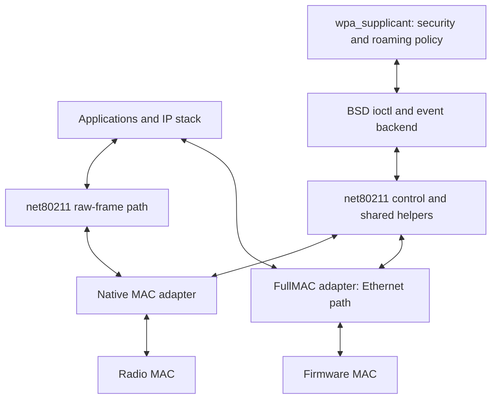

# Wi-Fi: stack, protocols, and driver boundaries

[Networking](networking.md) · [Modules](README.md) · [Driver integration](https://github.com/oxtech-ember/EmberBSD/blob/main/sys/net80211/docs/README.md)

EmberBSD uses net80211 for wireless interface control and shared protocol mechanisms.
A driver connects that stack to a radio. It does not own a second supplicant or a private copy of common protocol algorithms.
This page describes station mode: a device joining an access point (AP).
AP, monitor, IBSS, and mesh modes require their own driver paths and checks.

Hardware models, firmware applicability, wiring, and physical acceptance belong to
[DevBoards](https://github.com/oxtech-ember/EmberBSD-DevBoards/blob/main/docs/reader-guide.md).
This page describes software boundaries, not a second hardware support catalog.

## Two data paths, one BSD control interface

MAC means medium access control: the wireless link's frame and access operations.

**Native MAC:** the host sends and receives 802.11 frames.
net80211 handles frame construction, association state, and the enabled host protocol mechanisms.
The adapter programs the radio and moves frames through its bus and queues.

**FullMAC:** firmware handles association and much of the MAC data path.
The host data interface usually carries Ethernet frames.
The adapter translates common requests into firmware commands and reports their results.
Selected management frames still reach the host supplicant for SAE or roaming.

PCIe, SDIO, and USB are transports. They do not determine which MAC model a device uses.
Crypto offload is a separate choice: a native adapter can use authenticated hardware RX while retaining host TX protection.
A native adapter can also opt into [firmware ownership of pairwise TX](#who-owns-transmit-encryption) for the lifetime of a key.

The two net80211 boxes show responsibilities inside the same subsystem.
They are not separate network stacks or independently loadable services.
The FullMAC data path does not pass Ethernet payload through the raw-frame decoder.

## Who owns each operation

| Operation | Owner | Driver responsibility |
| --- | --- | --- |
| Network selection, credentials, SAE exchange, EAPOL key handshake | `wpa_supplicant` through its BSD backend | Transport required frames and events; apply the selected association and keys |
| Scan cache, station selection identity, ioctl validation | net80211 | Report observations and completion; reject stale firmware work |
| Raw association frames, WME negotiation, bounded HT/VHT negotiation | Native net80211 path | Supply qualified capabilities; apply channel, rate, power, and queue settings |
| Firmware association | Firmware and its adapter | Translate the selected request; report actual association IEs and link events |
| CCMP, protected management, replay checks | Host net80211 or explicitly selected firmware/hardware owner | Preserve the chosen ownership and key lifetime; report trusted hardware results |
| BlockAck windows and packet ordering | Shared net80211 mechanisms | Supply scheduling or firmware session metadata; implement hardware BlockAck operations |
| Registers, IRQ, DMA, firmware messages | Driver and bus attachment | Own buffers, command acknowledgements, reset, cancellation, and hardware drain |
| Power, reset, bus wiring, device properties | Platform description and providers | Consume properties instead of testing board names in protocol code |
| IP addresses and routes | Network configuration, such as dhcpcd | Expose a usable network interface; no DHCP logic in the radio driver |

Each key, replay counter, pending command, and retained packet needs one owner.
For example, FullMAC firmware can authenticate and decrypt data while the shared host reorder mechanism orders its output.
That does not authorize the host to reconstruct missing key or session identity from the latest connection.
The [offload receiver contract](https://github.com/oxtech-ember/EmberBSD/blob/main/sys/net80211/docs/net80211-rxba.md#firmware-offload-receiver)
defines that boundary.

The base system and the packaged supplicant use the same BSD backend from
the [Ports WPA recipe](https://github.com/oxtech-ember/EmberBSD-Ports/tree/main/pkgsrc/net/wpa_supplicant).
A fix to SAE key or controlled-port handling therefore reaches both builds.

## A connection from scan to stop

1. **Discover.** Collect beacon/probe information elements (IEs). An AP advertising HT, VHT, or SAE is a candidate, not an enabled local capability.
2. **Select and authenticate.** Bind work to the selected BSS and its association identity. The supplicant performs the selected authentication protocol.
3. **Associate.** The native stack or firmware negotiates with the AP. Only a matching result can enable the negotiated features.
4. **Install keys and authorize data.** The EAPOL handshake installs keys. The controlled port admits ordinary data only after the security path is ready. Association alone is insufficient.
5. **Run, rekey, or leave.** Check asynchronous events against their connection and operation identities. Retire the old session before reset or replacement; drain queues before freeing their owner.

ESP and Intel iwx report beacons and probe responses with the receive channel and
signal strength. The [net80211 scan input](https://github.com/oxtech-ember/EmberBSD/blob/main/sys/net80211/docs/net80211-beacon-ies.md#raw-scan-observations)
validates each report and updates the scan cache. This lets a station discover a
neighbor on another channel while retaining its home channel and association.
The adapter owns the firmware scan lifetime and identifies which reports belong to it.

Three identities solve different problems: association identity selects a BSS lifetime; key generation identifies a security lifetime;
an operation cookie identifies one asynchronous request. Reconnecting to the same BSSID does not revive old work.
See the [association lifecycle](https://github.com/oxtech-ember/EmberBSD/blob/main/sys/net80211/association-lifecycle.md)
and [SAE lifetime contract](https://github.com/oxtech-ember/EmberBSD/blob/main/sys/net80211/docs/sae.md).

## Roaming: what crosses the driver boundary

Consider a station that knows about two access points on the same network.
An 802.11k Neighbor Report gives the supplicant a list of potential neighbors.
An 802.11v BSS Transition Management (BTM) Request asks the station to consider a transition.
For an addressed request, the supplicant can use its network profile and scan results to
choose a candidate or decline the suggestion. It returns that decision to the AP.

| Boundary | What travels across it |
| --- | --- |
| Adapter → net80211 | The operations the adapter can transport: for example, requesting and receiving a Neighbor Report, receiving a measurement request, or sending a measurement report. Receiving an Action frame does not mean the radio can perform every measurement it describes. |
| net80211 ↔ BSD supplicant backend | Capabilities, received Action bodies, and send results associated with the current connection. A late completion from the previous association cannot complete a new request, even on the same AP. |
| Supplicant ↔ AP | Association capabilities and protocol messages. The host advertises operations it can actually serve; the supplicant interprets the candidate list and decides whether to move. |

A transmit operation has two independent results: whether the local transport succeeded,
and whether the peer acknowledged the frame at the MAC layer. Some radios supply no ACK
information. Local completion on such a radio leaves delivery unknown. Even a confirmed MAC
ACK does not say whether the AP or station accepted a transition.

For an AP-initiated test, correlate the incoming Request and outgoing Response by dialog token
and check the response status on the AP. A refusal demonstrates a working exchange.
To demonstrate a successful move, also verify the target BSSID, the negotiated security and
working data traffic after the transition. An association capability shown by a router,
a Neighbor Report, and an explicit client-initiated roam each answer a different question.
See the [station management contract](https://github.com/oxtech-ember/EmberBSD/blob/main/sys/net80211/docs/station-management.md)
and [shared supplicant recipe](https://github.com/oxtech-ember/EmberBSD-Ports/tree/main/pkgsrc/net/wpa_supplicant).

## Who owns transmit encryption

For native SAE, net80211 selects the owner of pairwise transmit encryption when it installs
a fresh key. Software normally owns encryption and the transmit packet number.
Providers implementing the TX contract can hand both to firmware. The experimental BE200
path in `iwx` implements the interface; its firmware TX profile still needs radio acceptance.
The same owner then protects data and robust unicast management frames that use that key.
Changing a group key preserves the pairwise key and its packet number. If firmware loses
counter state on reset, the connection must establish a fresh key before traffic resumes.

The [firmware TX provider contract](https://github.com/oxtech-ember/EmberBSD/blob/main/sys/net80211/docs/sae.md#firmware-tx-providers)
describes the implemented interface and the separate prerequisites for protected aggregation.
Availability of this interface does not establish radio acceptance for a particular adapter.

## Standards: what the software provides

This is a map of implemented mechanisms and their limits, not a certification claim.
The [reviewed source revision](../sources.md#wi-fi-review) fixes the scope of these statements.
An adapter must supply the missing hardware operations before it advertises a feature.

| Standard or feature | Current software boundary | Detailed owner |
| --- | --- | --- |
| 802.11a/b/g | Native legacy rates, scanning, authentication, association, and data framing. The adapter supplies usable bands, channels, rates, and radio operations. | [Core and driver entry points](https://github.com/oxtech-ember/EmberBSD/blob/main/sys/net80211/docs/README.md#base-interface) |
| 802.11e / WME-WMM QoS | Shared STA negotiation, traffic classification, and queue parameters. A strict native provider applies the complete parameter set before enabling QoS. | [WME](https://github.com/oxtech-ember/EmberBSD/blob/main/sys/net80211/docs/net80211-wme.md) |
| 802.11n / HT | Bounded native STA HT20 admission on 5 GHz, with provider checks for radio, power, protection, scheduling, reorder, and A-MSDU. FullMAC has its own firmware-qualified profile. This is not all HT modes. | [HT admission](https://github.com/oxtech-ember/EmberBSD/blob/main/sys/net80211/ieee80211_ht20.h), [aggregation](https://github.com/oxtech-ember/EmberBSD/blob/main/sys/net80211/docs/net80211-rxba.md) |
| 802.11ac / VHT | Shared IE decoding and bounded native 40/80 MHz negotiation; native use requires an explicit experimental provider. FullMAC enables VHT through its firmware contract. Experimental `iwx` additionally has an opt-in 160 MHz path; no general 160 MHz or 80+80 claim. | [VHT contract](https://github.com/oxtech-ember/EmberBSD/blob/main/sys/net80211/docs/net80211-vht-ies.md), [native provider](https://github.com/oxtech-ember/EmberBSD/blob/main/sys/dev/ic/docs/rtl8822ce-wifi5-experiment.md), [FullMAC example](https://github.com/oxtech-ember/EmberBSD/blob/main/sys/dev/sdmmc/docs/aicwf-vht.md), [iwx source](https://github.com/oxtech-ember/EmberBSD/blob/main/ember/development/iwx-be200/src/if_iwx_ht.h) |
| 802.11i / RSN (WPA2) | Supplicant key management and driver-selected ciphers; CCMP is the baseline for the modern station paths described here. | [Crypto](https://github.com/oxtech-ember/EmberBSD/blob/main/sys/net80211/docs/net80211-crypto.md) |
| WPA3-Personal / SAE and 802.11w PMF | Host SAE/EAPOL with a selected CCMP, required-PMF, BIP-CMAC-128 profile. Native and FullMAC use different key/crypto lifetimes. This does not establish WPA3-Enterprise support. | [SAE](https://github.com/oxtech-ember/EmberBSD/blob/main/sys/net80211/docs/sae.md), [BIP](https://github.com/oxtech-ember/EmberBSD/blob/main/sys/net80211/docs/net80211-bip.md) |
| 802.11k / 802.11v | Station transport for Neighbor Reports and BSS Transition Management, with connected scans and host candidate selection on implemented adapters. Not every RRM or WNM operation. | [Station management](https://github.com/oxtech-ember/EmberBSD/blob/main/sys/net80211/docs/station-management.md), [host roaming](https://github.com/oxtech-ember/EmberBSD/blob/main/sys/dev/ic/docs/bwfm-kv.md) |
| 802.11r / Fast Transition | The documented k/v path performs a new association. It does not supply FT roaming. | [Roaming boundary](https://github.com/oxtech-ember/EmberBSD/blob/main/sys/dev/ic/docs/bwfm-kv.md) |
| 802.11h functions | Native Quiet and channel-switch announcements can withdraw transmission through a provider. The experimental DFS-slave profile is not a DFS-master radar detector or a complete spectrum-management implementation. | [TX withdrawal](https://github.com/oxtech-ember/EmberBSD/blob/main/sys/dev/ic/docs/rtw88-tx-quiet.md), [experimental channel profile](https://github.com/oxtech-ember/EmberBSD/blob/main/sys/dev/ic/docs/rtl8822ce-wifi5-experiment.md) |
| 802.11ax / HE | No shared native HE negotiation/provider contract. Experimental `iwx` has opt-in 5 GHz HE up to 160 MHz, with firmware trigger/sounding responsibilities. MU EDCA, TWT, spatial reuse and larger BA windows are not integrated there. | [Common admission](https://github.com/oxtech-ember/EmberBSD/blob/main/sys/net80211/ieee80211_ht20.c), [iwx negotiation](https://github.com/oxtech-ember/EmberBSD/blob/main/ember/development/iwx-be200/src/if_iwx_ht.h), [integration limits](https://github.com/oxtech-ember/EmberBSD/blob/main/ember/development/iwx-be200/README.md) |
| 802.11be / EHT | No shared native EHT contract. Experimental `iwx` has opt-in single-link 5 GHz EHT at 80/160 MHz. MLO, puncturing, 320 MHz and 6 GHz are absent from that path. | [EHT admission and limits](https://github.com/oxtech-ember/EmberBSD/blob/main/ember/development/iwx-be200/src/if_iwx_ht.h) |
| 6 GHz / Wi-Fi 6E | No integrated native 6 GHz channel, discovery and association path in the reviewed stack. Firmware channel entries alone are insufficient. HE on 5 GHz does not establish 6 GHz support. | [Channel model](https://github.com/oxtech-ember/EmberBSD/blob/main/sys/net80211/_ieee80211.h), [iwx integration](https://github.com/oxtech-ember/EmberBSD/blob/main/ember/development/iwx-be200/src/if_iwx.c) |
| OWE, FT-SAE and WPA3-Enterprise suites | No end-to-end profile in the reviewed native SAE contract and BSD supplicant integration. The full supplicant build includes EAP methods; this does not establish these additional AKMs or PMF/cipher combinations. | [Selected RSN profile](https://github.com/oxtech-ember/EmberBSD/blob/main/sys/net80211/ieee80211_rsn.h), [BSD backend](https://github.com/oxtech-ember/EmberBSD-Ports/tree/main/pkgsrc/net/wpa_supplicant), [build profiles](https://github.com/oxtech-ember/EmberBSD/blob/main/external/bsd/wpa/bin/wpa_supplicant/Makefile) |

Native HT/VHT has deliberate standards deviations in
[mixed-mode protection](https://github.com/oxtech-ember/EmberBSD/blob/main/sys/net80211/docs/net80211-vht-ies.md#deviation-ht-protection-mode-3)
and [Basic VHT-MCS admission](https://github.com/oxtech-ember/EmberBSD/blob/main/sys/net80211/docs/net80211-vht-ies.md#deviation-basic-vht-mcs-set).
It accepts certain mixed-mode APs without RTS/CTS protection and can join a VHT BSS without supporting every advertised basic stream/rate tuple.
Those exceptions constrain standards conformance even when a connection works.

Channel legality, passive scanning, DFS behavior, power saving, and spatial streams remain explicit adapter constraints.
Parsing a wider-channel advertisement grants no permission to transmit on it.
Read the exact hardware profile in [DevBoards](https://github.com/oxtech-ember/EmberBSD-DevBoards/blob/main/catalog.json)
for physical applicability and evidence.

## Proposed architecture for the missing mechanisms

This is an extension proposal, not a claim that these interfaces exist.
The scope is the station paths above; AP, mesh and other radio families need their own capability review.
The [IEEE working-group overview](https://ieee802.org/11/overview.html) distinguishes HE, EHT and other amendments;
implementing one optional feature does not establish the complete standard or Wi-Fi certification.

Keep one net80211 control model and the BSD supplicant backend.
Move standard IE parsing, capability intersection and association decisions out of the experimental adapter
into the common owner, extending the existing HT/VHT, WME and aggregation mechanisms.
The driver supplies local capabilities and applies the negotiated result through its real firmware ABI.
FullMAC adapters report firmware-negotiated results and ownership explicitly, without running a second host association state machine.

| Missing or partial mechanism | Common responsibility | Adapter responsibility |
| --- | --- | --- |
| Shared HT/VHT/HE/EHT negotiation | Parse peer IEs once; intersect peer, local, regulatory and configured limits; keep one negotiated mode visible to status and consumers | Report supported bands, widths, streams, rates and operations; translate the result to PHY/MAC/link commands |
| HE multi-user operation, MU EDCA, TWT and spatial reuse | Validate negotiated features; own queue policy and wake agreements; declare which time-critical operations firmware owns | Execute trigger-based PHY operations, queue parameters and wake schedules; report completion, expiry and loss of state |
| Larger BlockAck windows and aggregation | Extend shared session, reorder, replay and queue bounds together; retain PMF admission | Apply supported limits and report aggregation/session identity; do not infer security from a BA identifier |
| 6 GHz discovery and channel control | Represent band/frequency separately from channel number; validate discovery, security profile, channel width and transmit restrictions together | Supply NVM/firmware constraints and current regulatory results; execute only admitted scan and channel requests |
| EHT puncturing and 320 MHz | Validate the whole channel layout, disabled subchannels and negotiated rates against regulatory and peer limits | Program the exact supported layout; reject unsupported operations before transmission |
| MLO | Add an explicit multi-link device/peer owner with subordinate link lifetimes, TID-to-link mapping and cipher-defined key/PN/replay relationships | Expose link handles and queue constraints; report per-link events under the parent association identity |
| FT roaming and additional RSN profiles | Keep authentication, credentials and roam policy in the supplicant; extend common association/key transitions and PMF/cipher validation | Transport the selected authentication/action exchange and install its keys; never infer FT from a fast reconnect |

For MLO, single-link EHT remains a useful first stage. Do not model multiple links as unrelated interfaces
sharing a password: link removal, queued packets and security state must remain bound to the parent connection.
For 6 GHz, complete discovery and the selected security requirements, including SAE H2E/RSNXE where applicable,
must be checked end to end; existing SAE code or a 6 GHz firmware channel table is not sufficient.

This follows the useful separation in
[FreeBSD net80211 crypto](https://github.com/freebsd/freebsd-src/blob/main/sys/net80211/ieee80211_crypto.c),
[Linux mac80211 offload contracts](https://docs.kernel.org/driver-api/80211/mac80211-advanced.html#hardware-crypto-acceleration)
and [cfg80211 capability/channel control](https://docs.kernel.org/driver-api/80211/cfg80211.html).
Reuse those design boundaries and applicable BSD code with its provenance; keep EmberBSD's native control interface.
A private protocol implementation per driver would repeat negotiation and security state.
Replacing the whole stack would also require migrating working native and FullMAC consumers; it is unnecessary for these extensions.

Recommended order: qualify TX offload and protected aggregation on the radio first; consolidate common mode/channel negotiation
while moving existing consumers; then qualify single-link HE/EHT. Add 6 GHz, puncturing and MLO through their explicit contracts.
FT and additional authentication profiles can progress in the supplicant/common security owner independently.
For each step, test the shared mechanism and adapter errors before physical acceptance; keep unsupported capabilities disabled.

## Adding a driver

1. Choose the MAC and crypto ownership from the device's real host/firmware interface. State the frame format at each boundary.
2. Connect device attach/stop/detach, the network interface, channels, and legacy frame transport. Make reset and failure cleanup work first.
3. Use the shared control path and existing supplicant. Implement the chosen security transport and key retirement before advertising it.
4. Add QoS, HT/VHT, aggregation, or connected scanning only when their provider prerequisites are met. Leave absent capabilities disabled.
5. Put a missing common protocol operation in net80211 or the supplicant. Put register and firmware translation in the adapter.
6. Run the relevant owner contracts, build the affected kernel/modules, then test the actual radio path. Publish hardware results in DevBoards.

The [driver integration map](https://github.com/oxtech-ember/EmberBSD/blob/main/sys/net80211/docs/README.md)
names the callbacks, headers, reference consumers, and executable checks for each step.
It is the place to look up interfaces; this page explains why those interfaces are separate.
